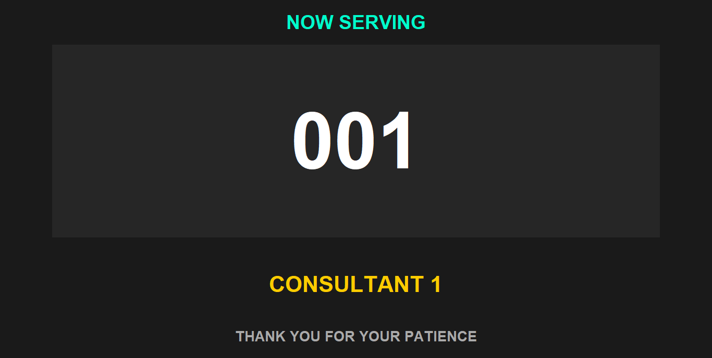
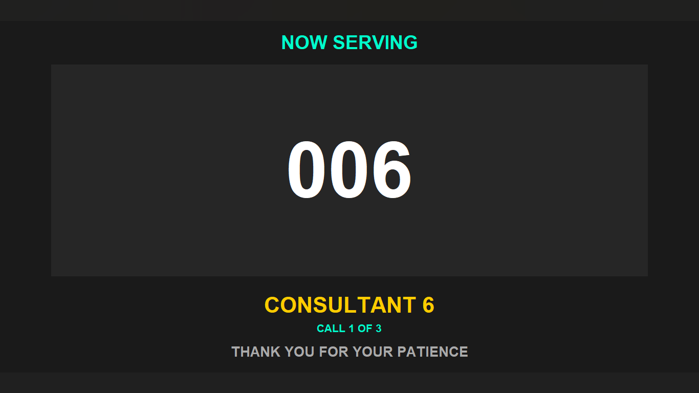

# Bank Queue Management System

A Python-based queue management simulation for a bank branch. This repository contains a unified and refactored implementation that centralizes queue logic into a shared core so multiple scripts (final app, monitor, and prototypes) operate on the same state.

This is an educational, single-PC simulation, not software for real banking operations.

## What changed

The staff controller, staff monitor, and client-facing monitor share a local SQLite database:

- `queue_core.py` contains transactional state updates, ticket generation and recovery, queue management for eight consultants, and wait-time scheduling.
- `Final Product_demo.py` provides the staff CLI controller and refreshes state between menu actions.
- `Consultant_Monitor_Display.py` is a live dashboard for the waiting queue, consultant assignments, and recent calls, with an arrival-confirmation action for the selected called ticket.
- The staff controller and monitor open directly in prototype mode without employee login or account setup.
- `Client_Monitor_Display.py` calls one active ticket at a time, repeating it three times before moving to the next held call.
- Existing JSON state is imported once when the SQLite database is first created. The original `queue_state.json` is left unchanged.
- Prototype scripts use the shared root-level `queue_core.py` from their phase packages.

SQLite transactions prevent concurrent local controller instances from issuing duplicate tickets or overwriting each other's queue updates.

## Monitor Preview

The client monitor displays one ticket, its consultant destination, and the current call attempt. It does not display staff queue totals or consultant status details. When several consultants call clients at once, calls are presented in ticket order rather than simultaneously.





The monitor repeats each ticket every 5 seconds. After the third call, it allows 10 seconds for the client to respond. Unanswered tickets are marked as no-shows, their consultant is freed, and the next active call is shown.

## Files of interest

- `queue_core.py` — shared queue logic, SQLite persistence, and wait estimates
- `Final Product_demo.py` — main staff CLI
- `Consultant_Monitor_Display.py` — staff-facing live dashboard
- `Client_Monitor_Display.py` — Tkinter client-facing display
- `single_ticket_demo.py`, `repeat_service_ticket_demo.py`, `continuous_ticket_sequence_demo.py`, `wait_time_estimate_demo.py` — prototype demos
- `client_monitor/` — both client-monitor screenshots
- `single_ticket_demo.py`, `repeat_service_ticket_demo.py`, `continuous_ticket_sequence_demo.py`, `wait_time_estimate_demo.py` — focused prototype demos
- queue_state.sqlite3 — runtime database (created on first run)
- test_queue_core.py — automated queue-core tests
- queue_state.json — legacy state imported once if no SQLite database exists

## Requirements

- Python 3.8+ recommended
- `tkinter` (required for both monitor windows), usually included with desktop Python
- No third-party Python packages are required

## Run on Windows

Run commands from the repository root. Open three terminals and start the staff controller in one:

```powershell
py ".\Final Product_demo.py"
```

Start the client-facing monitor in the other:

```powershell
py ".\Client_Monitor_Display.py"
```

Start the staff-facing dashboard in the third:

```powershell
py ".\Consultant_Monitor_Display.py"
```

The staff controller and staff monitor start without login prompts. `Call next client` automatically assigns the next ticket to the next available consultant. In the staff monitor, use `View full queue` and `Consultant status`; select the row marked `CALLING` and use `Arrived` to confirm arrival. Enter minutes for `Advance time`, or a waiting ticket number for `Cancel ticket`. The controller CLI keeps its numbered actions; option `11` asks for the ticket number shown on the client monitor. Staff actions are recorded as `Local staff`; individual employee accountability is not enabled in this prototype. The client-facing monitor remains public and read-only.

On systems without the Windows `py` launcher, replace `py` with `python` or `python3`.

## Tests

Run the standard-library test suite from the repository directory:

```powershell
py -m unittest discover -v
```

The tests use temporary database and legacy-state files; they do not modify the runtime queue.

## Prototype Demos

These scripts share the same local queue state:

```powershell
py ".\single_ticket_demo.py"
py ".\repeat_service_ticket_demo.py"
py ".\continuous_ticket_sequence_demo.py"
py ".\wait_time_estimate_demo.py"
```

## Notes & recommendations

- SQLite is the source of truth after the one-time JSON import. It serializes local updates and recovers ticket numbering from existing assignments.
- The client call cycle is persisted, so restarting the monitor does not reset the three-call count. No-shows and completed services appear in the staff activity log.
- Wait estimates schedule existing FIFO tickets against each consultant's remaining busy time. They assume staff call the next client promptly when a consultant becomes available.
- The controller and monitors share local state on one computer; this prototype has no employee login and is not production software.
- Use simulated data only. Do not enter real customer information.

## Author

Kaaamohelo
